# Tutorial IEEE VIS 2026
{: .no_toc }

[Link to Tutorial Proposal](files/tutorial_vis26.pdf){: .btn .btn-purple }
[Download all handouts (.zip)](files/vis2026/vis2026-tutorial-materials.zip){: .btn }

---

In this tutorial, small groups model how a renter decides on an apartment using the three tasks of the typology (**choose**, **activate** and **create**). They then use that model to find what a real apartment-search site misses, and sketch visualization designs for those gaps.

Everything runs on four printed handouts. This page explains what each one is for and how to use it. Click any preview to see the page at full size.

On this page

1. TOC
{:toc}

---

## The handouts at a glance

| Handout | Used in | What it's for | Pages |
| --- | --- | --- | --- |
| [Typology Reference Guide](#typology-reference-guide) | Both sessions | The three tasks, the notation and a worked example | 1 (two copies per page) |
| [Persona Cards](#persona-cards) | Both sessions | The renter your group interviews and designs for | 6 (3 cards, front and back) |
| [Sheet 1 – Modeling the Decision](#sheet-1--modeling-the-decision) | Session 1 | Interview steps, plus space to draw the decision diagram | 2 |
| [Sheet 2 – From Diagram to Design](#sheet-2--from-diagram-to-design) | Session 2 | Audit table for apartments.com, plus space to sketch designs | 3 |

## How the sheets fit together

1. **Session 1:** the group interviews the renter (persona card) and draws how they decide on **Sheet 1**, using the shapes from the **reference guide**. Each task in the diagram gets a number: N1, N2, N3, …
2. **Session 2:** the group takes those numbered tasks to **Sheet 2**. They check each one against apartments.com, pick a gap with the renter, and sketch designs tagged with the same node numbers.

The node numbers connect the two sessions. **Keep Sheet 1 and the persona card for Session 2.**

### Form your group

Before the interview, split three roles (listed on Sheet 1):

- **Renter:** holds the persona card and answers as that person.
- **Interviewer:** asks the questions and keeps the renter talking.
- **Diagrammer:** draws the diagram. In a pair, the interviewer also draws.

Each group works with one persona: **A · Maya**, **B · Priya** or **C · Sam**.

---

## Typology Reference Guide

A one-page summary of the typology to keep in front of you during both sessions.

**How to use it**

- When you're not sure which shape a step should be, ask the guide's three questions:
  - *Does this step produce something new?* → **create** (triangle)
  - *Can each option be judged on its own?* → **activate** (square)
  - *Does an option's fate depend on the others?* → **choose** (circle)
- Draw an **arrow** when one task's output feeds the next task, and label it with what flows (e.g., "candidates").
- Draw a dashed **loop** when a task repeats because criteria change or the process steps back.
- The wildfire evacuation example shows a complete diagram, including a loop.

**Printing:** each page holds two copies. Cut along the dashed line and give one half to each participant.

  <figure>
    <a href="img/vis2026/typology-reference-guide-p1.png">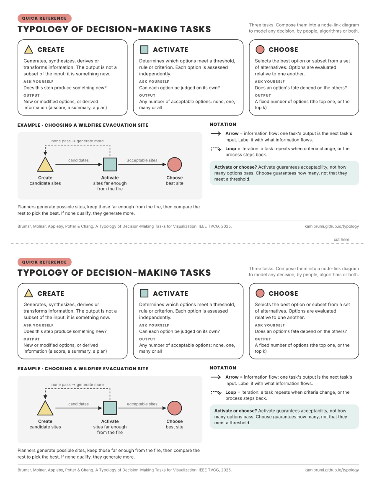</a>
    <figcaption>Page 1 · two copies, cut in half</figcaption>
  </figure>

[Download the Reference Guide (PDF)](files/vis2026/typology-reference-guide.pdf){: .btn .btn-outline }

---

## Persona Cards

Three renters, each with a different apartment-search problem:

- **A · Maya:** a postdoc moving to Boston with a partner and a 55 lb dog.
- **B · Priya:** relocating from overseas with her family, and signing a lease without visiting.
- **C · Sam:** searching for a place for four grad-student roommates, any of whom can veto.

**How to use them (for the renter)**

1. Read the front aloud to start the interview, then talk as that person.
2. Bring in the details on the back as the conversation goes. Don't read the list out.
3. If you're asked something that isn't on the card, make up a small, realistic answer that fits the character.
4. Keep the card for Session 2. The **For Session 2** box on the back says what frustrates this person most about searching. Use it when you react to the group's sketches.

**Printing:** print double-sided so each card's details land on its back. Each group needs one card.

  <figure>
    <a href="img/vis2026/persona-cards-p1.png">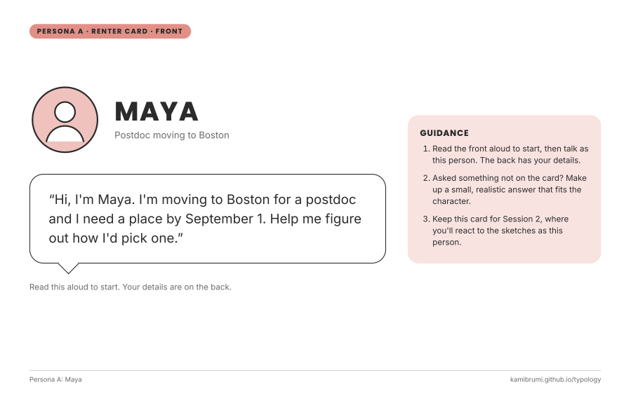</a>
    <figcaption>A · Maya, front</figcaption>
  </figure>
  <figure>
    <a href="img/vis2026/persona-cards-p2.png">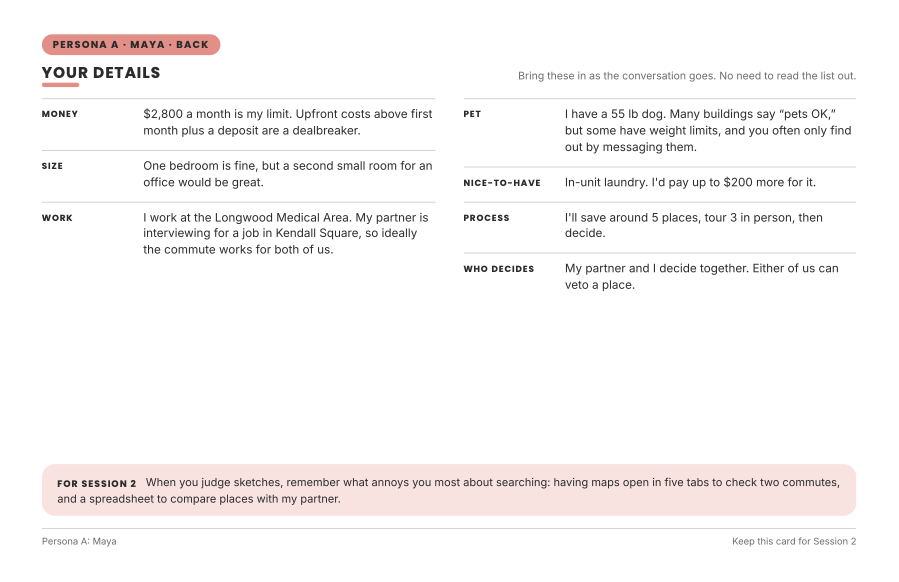</a>
    <figcaption>A · Maya, back</figcaption>
  </figure>
  <figure>
    <a href="img/vis2026/persona-cards-p3.png">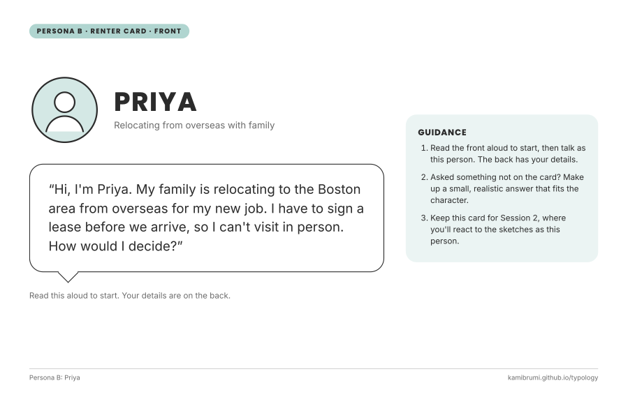</a>
    <figcaption>B · Priya, front</figcaption>
  </figure>
  <figure>
    <a href="img/vis2026/persona-cards-p4.png">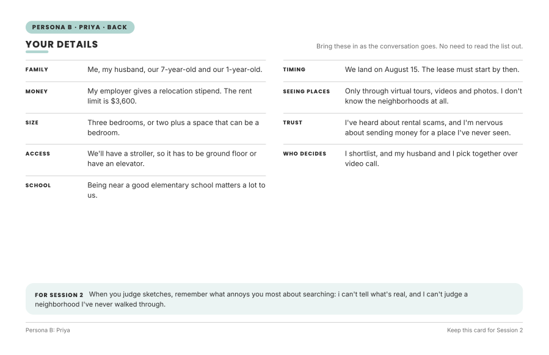</a>
    <figcaption>B · Priya, back</figcaption>
  </figure>
  <figure>
    <a href="img/vis2026/persona-cards-p5.png">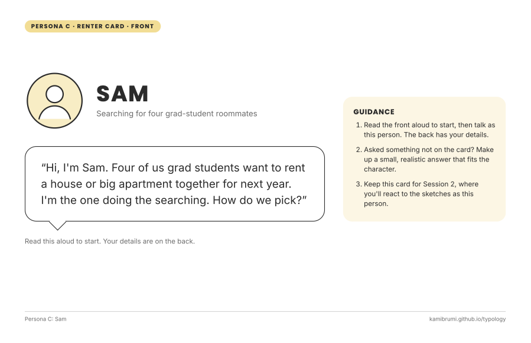</a>
    <figcaption>C · Sam, front</figcaption>
  </figure>
  <figure>
    <a href="img/vis2026/persona-cards-p6.png">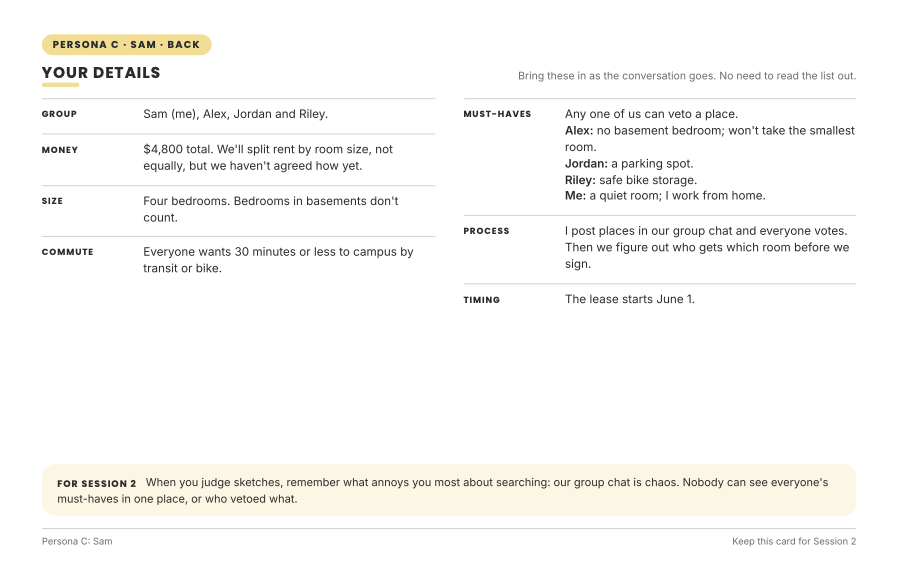</a>
    <figcaption>C · Sam, back</figcaption>
  </figure>

[Download the Persona Cards (PDF)](files/vis2026/persona-cards.pdf){: .btn .btn-outline }

---

## Sheet 1 – Modeling the Decision

**Session 1.** Diagram how your renter decides on an apartment, using only choose, activate and create. Treat it as an interview, not a website review: model how the *person* decides, not how any interface works.

**How to use it**

1. **Interview the renter and draw the diagram (~20 min).** Use the interview starters on page 1, and follow up on every answer: the details come out in conversation. Aim for one top-level decision and at least three tasks linked to it. Draw on the dot grid on page 2.
2. **Clean up and number the nodes (~5 min).** Number every task N1, N2, N3, … and label every arrow with what flows along it (e.g., "candidate listings"). You'll use these numbers in Session 2.
3. **Show the room (2 min per group).** Present your diagram and point out where the decision looped back.

  <figure>
    <a href="img/vis2026/sheet1-modeling-the-decision-p1.png">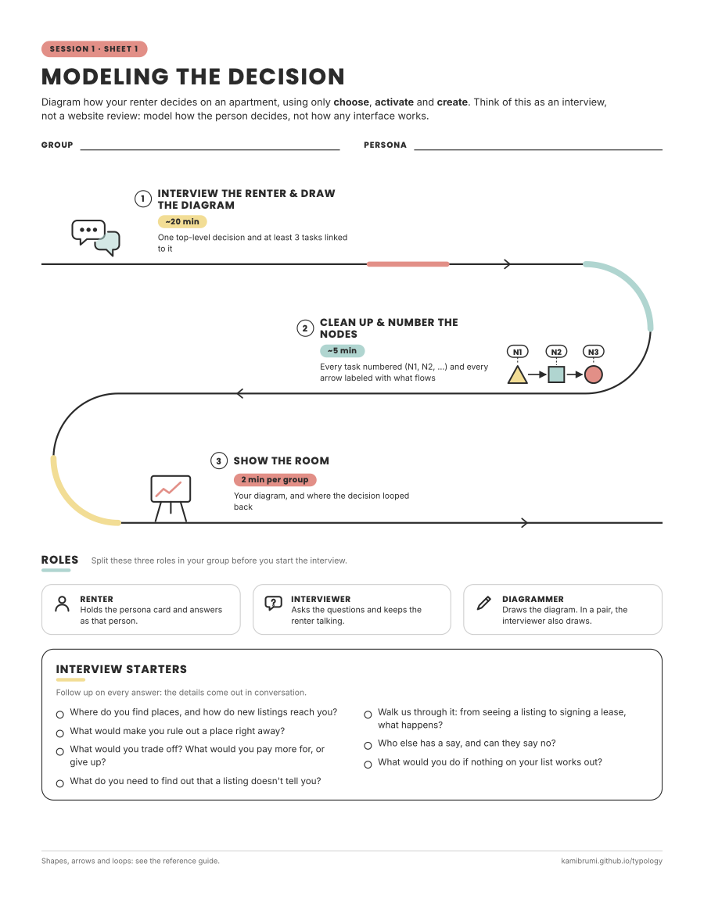</a>
    <figcaption>Page 1 · steps, roles, interview starters</figcaption>
  </figure>
  <figure>
    <a href="img/vis2026/sheet1-modeling-the-decision-p2.png">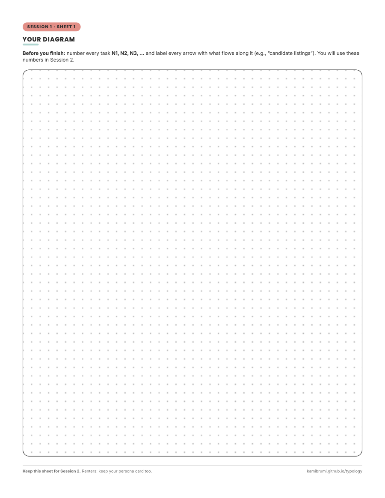</a>
    <figcaption>Page 2 · your diagram</figcaption>
  </figure>

[Download Sheet 1 (PDF)](files/vis2026/sheet1-modeling-the-decision.pdf){: .btn .btn-outline }

---

## Sheet 2 – From Diagram to Design

**Session 2.** Check which parts of your renter's decision apartments.com supports, then design for what it misses. Work from your Sheet 1 diagram and its numbered tasks. Your renter is still the expert, so ask whether a design would actually help.

**How to use it**

1. **A · Audit apartments.com (~15 min).** Start from a city search (e.g., Boston, MA) and audit only your numbered nodes. For each node, fill in the table on page 1: is it supported (yes / partial / no), where on the site, and what's missing. Use this test: *what would the renter have to do outside the site to finish this?* A spreadsheet, a map in another tab or a text to a partner means there's a gap, even if a feature exists.

   | What's missing | Meaning |
   | --- | --- |
   | **Data** | The site doesn't have the information. |
   | **Interaction** | It's there, but you can't act on it the way the renter needs. |
   | **Visual encoding** | You can act on it, but can't see what the decision needs. |

   Note any features that match no node. Is that a node missing from your diagram, or a feature that isn't a decision task?

2. **B · Pick 1–2 gaps with your renter (~5 min).** Ask the renter which unsupported node matters most, and circle it in the audit table. On the **Gap 1** page, write the question the renter needs answered (in their words) and the type of data involved (quantitative, categorical, geographic, temporal or uncertain).
3. **C · Brainstorm encodings and interactions, then sketch (~20 min).** Sketch two ideas, one per box. Use the task type to get started:

   | Task type | Often suggests |
   | --- | --- |
   | **Activate** | Thresholds on distributions, brushing, pass / fail / unknown marks, near-miss views |
   | **Create** | What-if panels, generated options shown with where they came from |
   | **Choose** | Side-by-side comparison, small multiples, ranking with adjustable weights |
   | **Loops** | History, before/after diffs, undoing a criterion |

   Under each sketch, write the interaction and how it follows from the task type. The renter ticks **Our renter's pick**.
4. **D · Label your sketches with node numbers (~5 min).** Tag every part of each sketch with the node it supports (N1, N2, …).
5. **Show the room (2 min per group).** Present your gap, your two ideas, and which one your renter picked.

The **Gap 2** page (page 3) is optional, for groups that have time for a second gap.

  <figure>
    <a href="img/vis2026/sheet2-from-diagram-to-design-p1.png">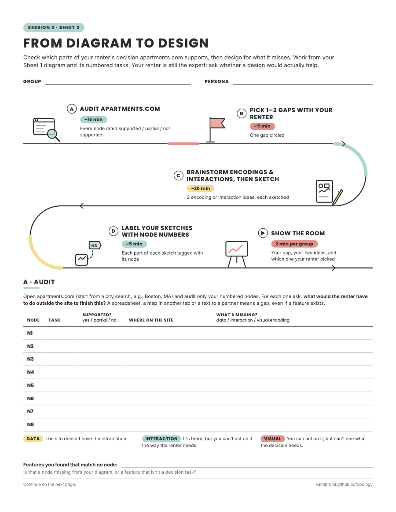</a>
    <figcaption>Page 1 · steps and audit table</figcaption>
  </figure>
  <figure>
    <a href="img/vis2026/sheet2-from-diagram-to-design-p2.png">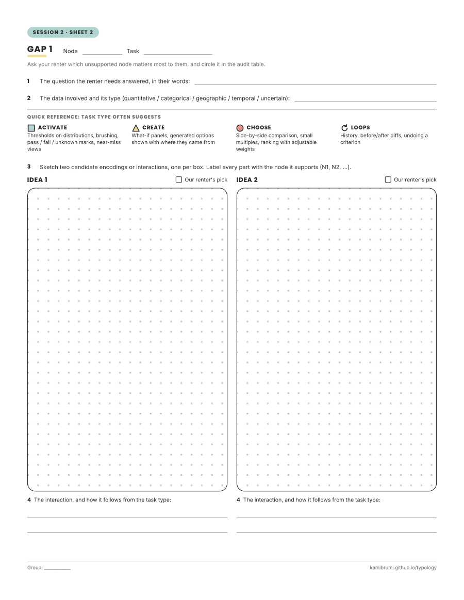</a>
    <figcaption>Page 2 · Gap 1</figcaption>
  </figure>
  <figure>
    <a href="img/vis2026/sheet2-from-diagram-to-design-p3.png">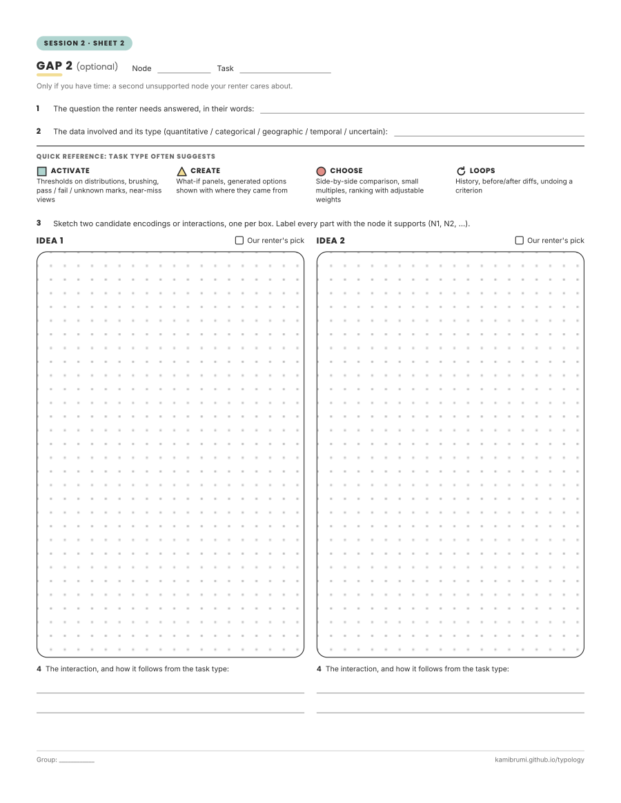</a>
    <figcaption>Page 3 · Gap 2 (optional)</figcaption>
  </figure>

[Download Sheet 2 (PDF)](files/vis2026/sheet2-from-diagram-to-design.pdf){: .btn .btn-outline }

---

## Printing checklist

**For each participant**
- [ ] Half a page of the Typology Reference Guide (cut on the dashed line)

**For each group**
- [ ] One persona card, printed double-sided
- [ ] Sheet 1 (2 pages)
- [ ] Sheet 2 (3 pages)
- [ ] A laptop or phone to open apartments.com in Session 2

[Download all handouts (.zip)](files/vis2026/vis2026-tutorial-materials.zip){: .btn .btn-purple }
